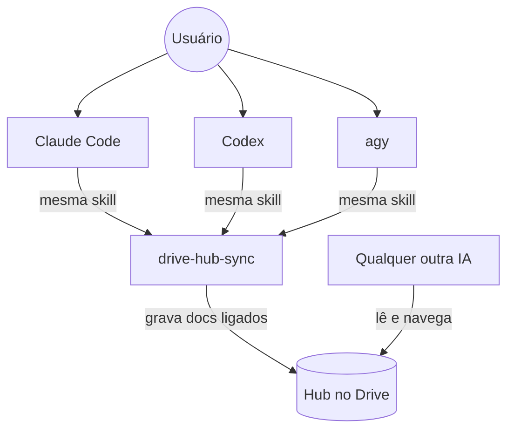
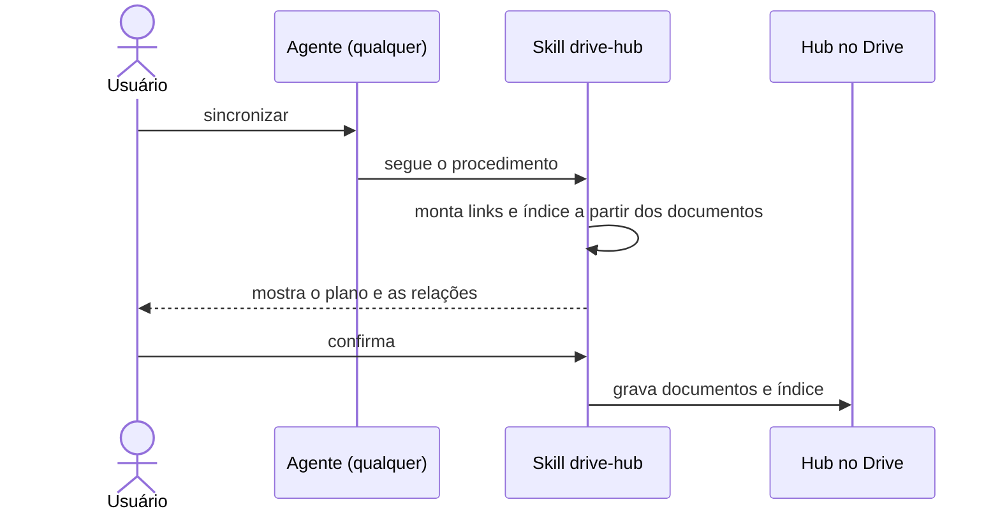

# Critérios ffd2: hub em grafo e suporte a Claude Code, Codex e agy

## Restrições (Constitution)
`ARQ-04` sem runtime novo; `ARQ-06` contratos explícitos; `DUP-06` e `DUP-10` regras e instruções em um só lugar; `SEG-02` escrita só em `hubPath`; `SEG-07` consultar a doc oficial do Codex antes de fixar o adaptador; `FLX-05` ADR para a decisão estrutural; `TST-01` critério executável.

## Modelo do módulo (`ARQ-11`)
**enxuto.** Muda texto de skill, templates e adaptadores, sem código. Não há runtime nem estado novo.

## Decisões do projeto aplicadas
- ADR-0001: skill como fonte única; novos adaptadores finos.
- ADR-0002: só documentação vai ao Drive; confirmação antes de gravar.
- ADR-0003: configuração em `.drive-hub.json`, fora do git.

## O que já existe
| Procurei | Onde | Achei | Decisão | Justificativa |
|----------|------|-------|---------|---------------|
| Regras do hub | `skills/drive-hub/SKILL.md` | Estrutura, config, regras, procedimentos | estender | Seção de grafo e links |
| Adaptador Claude Code | `commands/`, `.claude-plugin/` | `/drive-setup`, `/drive-sync` | reusar | Sem mudança |
| Adaptador agy | `skills/drive-hub/` (cópia manual) | Procedimentos sem comando de barra | reusar | Base também para o Codex |
| Adaptador Codex | todo o repo | nada | criar | Fino, apontando para a skill |
| Templates do hub | `templates/hub/` | Esqueleto 00 a 04 sem links entre docs | estender | Seção "Relacionados" e índice |
| Mapeamentos SDD | `templates/mappings.sdd.json` | release, arquitetura, marketing | estender | Origens que alimentam as relações |

## Dependências novas
Nenhuma no plugin. O formato do adaptador do Codex vem da documentação oficial, consultada na task 1.

## Diagramas (C4)

```mermaid
graph LR
  A1[commands: Claude Code] --> Skill[skills/drive-hub]
  A2[Adaptador Codex] --> Skill
  A3[Skill direta: agy] --> Skill
  Skill --> Tpl[templates/hub com links]
  Skill --> Idx[Índice de relações]
  Tpl --> Hub[(hubPath)]
  Idx --> Hub
```

## Critérios de aceitação
1. ADR-0004 aprovada define o padrão de grafo (links relativos e índice) e cita a doc oficial consultada do Codex.
2. Adaptador do Codex existe no repositório e só referencia a skill: `grep -c "skills/drive-hub" <arquivo>` retorna 1 ou mais, e ele não repete as regras de exclusão.
3. Todo template em `templates/hub/` tem a seção `Relacionados` com links relativos válidos: um script de checagem (shell) resolve cada link e retorna 0 sem links quebrados.
4. O índice de relações lista todos os documentos do hub: contagem de arquivos `.md` do esqueleto igual à de entradas no índice.
5. `SKILL.md` descreve a instalação e o uso nos três agentes, e o README tem uma tabela com os três.
6. Código-fonte continua recusado: nenhuma regra de exclusão foi removida (`git diff` de `SKILL.md` sem remoções da seção `## Regras`).
7. `forge brief --check` retorna 0 e `forge gate` passa.
8. Teste manual (`TST-01`, sem teste automatizado): em cada um dos 3 agentes, `setup` e `sync` geram o mesmo hub no hub de exemplo.
