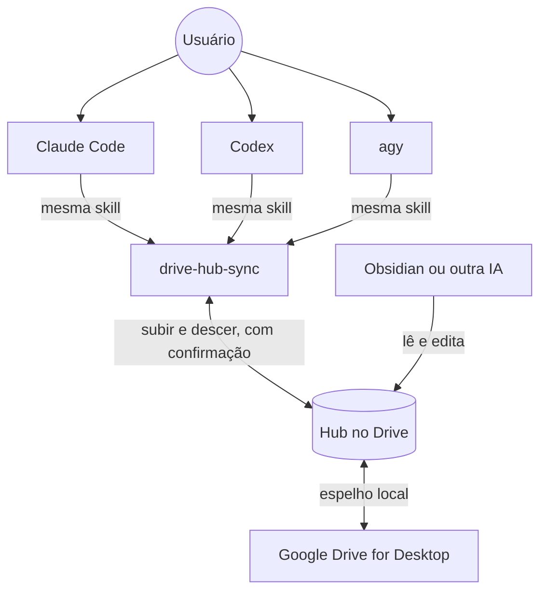
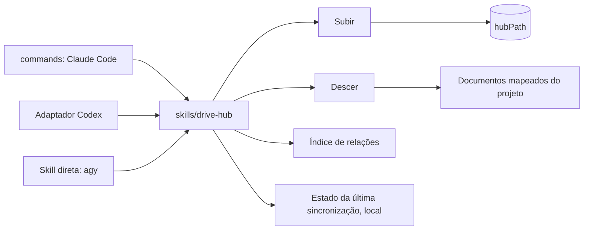
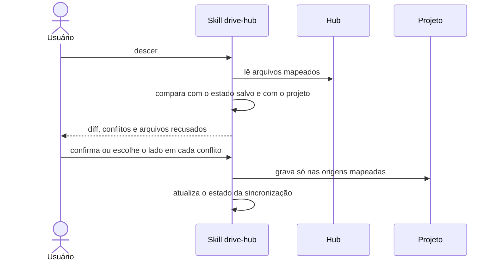

# Critérios ffd2: sync bidirecional, grafo e Claude Code, Codex e agy

## Restrições (Constitution)
`ARQ-04` sem runtime novo; `ARQ-05` simulação sem efeito (o plano confirmado faz esse papel); `ARQ-06` contratos explícitos; `DUP-06` e `DUP-10` regras em um só lugar; `SEG-01` entrada validada (conteúdo do hub é dado não confiável); `SEG-02` escrita dentro do diretório-alvo, preservando dados existentes; `SEG-04` e `SEG-05` sem segredos nem caminho pessoal no repositório; `SEG-07` doc oficial do Codex antes do adaptador; `FLX-05` e `GOV-01` ADR para a mudança; `TST-01` critério executável.

## Modelo do módulo (`ARQ-11`)
**completo** para o procedimento de descer (nova direção de escrita, com risco de perda de dados). **enxuto** para links, índice e adaptadores (só texto e templates). Justificativa: descer altera onde o plugin escreve.

## Decisões do projeto aplicadas
- ADR-0001: skill como fonte única; adaptadores finos.
- ADR-0002: só documentação circula; confirmação antes de gravar. **Será ajustada** para cobrir a volta.
- ADR-0003: configuração em `.drive-hub.json`, fora do git. **Será ajustada** para incluir o estado de sincronização.

## O que já existe
| Procurei | Onde | Achei | Decisão | Justificativa |
|----------|------|-------|---------|---------------|
| Regras do hub e exclusão de código | `skills/drive-hub/SKILL.md` | Estrutura, config, regras, procedimentos | estender | Seção de descer, grafo e conflitos |
| Subir | `commands/drive-sync.md` | Resume, confirma, grava | reusar | Sem mudança de comportamento; ganha links e índice |
| Adaptador Claude Code | `commands/`, `.claude-plugin/` | `/drive-setup`, `/drive-sync` | estender | Novo comando de descer |
| Adaptador agy | `skills/drive-hub/` (cópia manual) | Procedimentos sem comando de barra | estender | Procedimento de descer; base para o Codex |
| Adaptador Codex | todo o repo | nada | criar | Fino, aponta para a skill |
| Descer / estado da última sincronização | todo o repo | nada | criar | Capacidade inexistente |
| Config do usuário | `.drive-hub.json` | `hubPath`, `mappings` | estender | Mapeamentos passam a valer nos dois sentidos |
| Templates do hub | `templates/hub/` | Esqueleto 00 a 04 sem links | estender | Seção `Relacionados` e índice |
| Mapeamentos SDD | `templates/mappings.sdd.json` | release, arquitetura, marketing | estender | Cada mapeamento declara se aceita descer |

## Dependências novas
Nenhuma no plugin. O Obsidian é opcional e do usuário. O formato do adaptador do Codex vem da documentação oficial, consultada na task 1.

## Diagramas (C4)

## Critérios de aceitação
1. ADR-0004 aprovada define: sync nos dois sentidos, política de conflito, formato do estado, padrão de grafo e adaptador Codex. ADR-0002 e ADR-0003 têm nota de ajuste referenciando a ADR-0004.
2. Existe `commands/drive-pull.md` (nome final a definir) e o procedimento equivalente na skill. O comando só referencia a skill: `grep -c "skills/drive-hub" commands/drive-pull.md` retorna 1 ou mais, sem repetir a lista de exclusão.
3. A skill declara, para descer: escrita só nas origens mapeadas, só nas extensões permitidas, dentro da raiz do projeto, e conflito sempre pergunta. Cada afirmação é verificável por `grep` no texto.
4. O estado da sincronização fica fora do git: o arquivo está no `.gitignore` e o template não contém caminho pessoal (`grep -rn "CloudStorage/GoogleDrive-"` sem ocorrências fora de exemplos).
5. Todo template em `templates/hub/` tem a seção `Relacionados`, e um script de shell resolve cada link relativo e retorna 0 sem links quebrados.
6. O índice de relações lista todos os `.md` do esqueleto: contagem de arquivos igual à de entradas.
7. Adaptador do Codex existe, só referencia a skill e cita a doc oficial consultada. README e `SKILL.md` têm a instalação nos três agentes e um guia curto de Obsidian.
8. `.obsidian/` está na lista de ignorados da subida e da descida, e nenhuma regra de exclusão da skill foi removida (`git diff` sem remoções na seção `## Regras`).
9. `forge brief --check` retorna 0 e `forge gate` passa.
10. Teste manual (`TST-01`, sem teste automatizado), num hub de exemplo:
    - subir cria o hub com links;
    - editar um `.md` no hub e descer atualiza só o documento mapeado;
    - editar os dois lados faz o plugin perguntar e não sobrescrever;
    - um `.js` colocado no hub é recusado na descida.

    O mesmo resultado nos 3 agentes.
