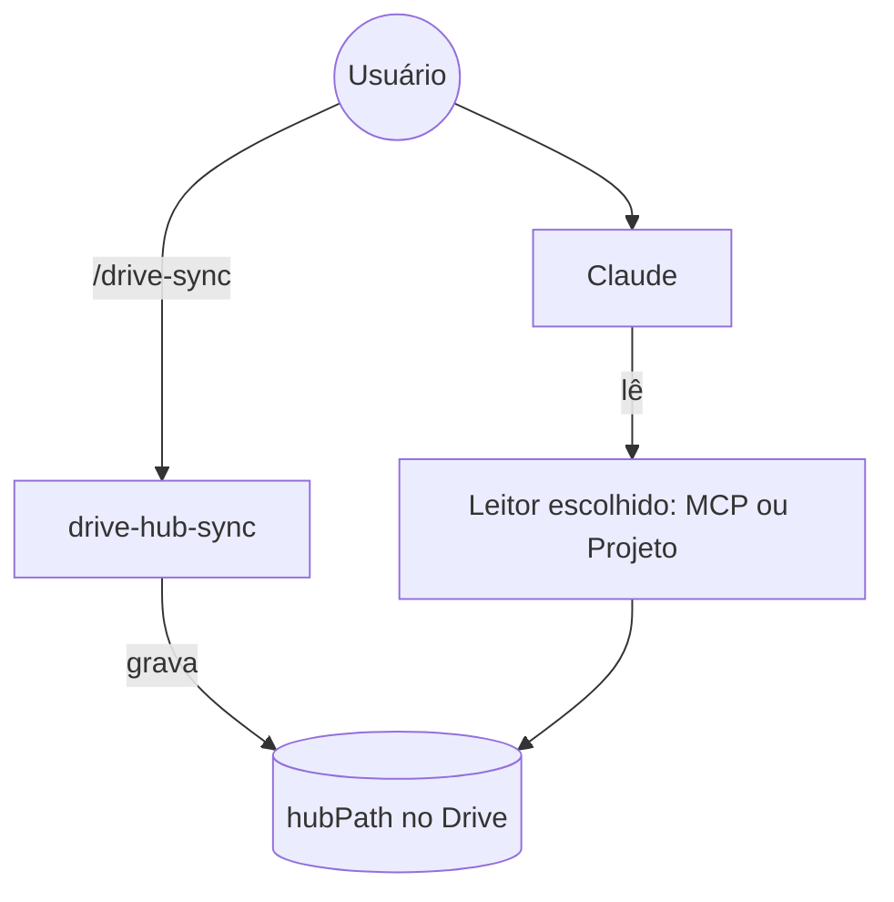
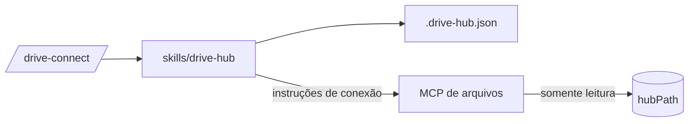
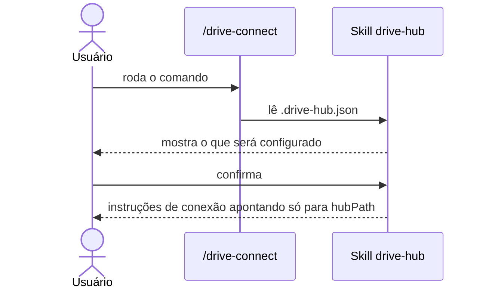

# Critérios ffd2: integração do hub com o Claude

## Restrições (Constitution)
`ARQ-04` sem runtime novo; `ARQ-06` contrato público explícito; `SEG-02` leitura limitada ao `hubPath`; `SEG-04` sem credencial no repo; `SEG-07` consulta prévia ao context7 para qualquer lib ou servidor MCP; `DUP-10` regras só na skill; `TST-01` critério executável.

## Modelo do módulo (`ARQ-11`)
**enxuto.** Muda texto de skill e comando, sem código. Justificativa: não há runtime nem estado novo.

## Decisões do projeto aplicadas
- ADR-0001: skill como fonte única; o novo comando é adaptador fino.
- ADR-0002: o que o Claude lê é só o que já é permitido no hub.
- ADR-0003: configuração fica em `.drive-hub.json` (campo novo opcional), fora do git.

## O que já existe
| Procurei | Onde | Achei | Decisão | Justificativa |
|----------|------|-------|---------|---------------|
| Regras do hub | `skills/drive-hub/SKILL.md` | Estrutura, config e regras | estender | Nova seção "Conectar ao Claude" |
| Comando de entrada | `commands/` | `/drive-setup`, `/drive-sync` | criar | Passo novo e distinto (`/drive-connect`) |
| Leitura do hub pelo Claude | todo o repo | nada | criar | Capacidade inexistente |
| Config do usuário | `.drive-hub.json` | `hubPath`, `mappings` | estender | Campo opcional, sem quebrar o formato |

## Dependências novas
Nenhuma no plugin. Se a opção escolhida usar um MCP de terceiros, ele é pré-requisito do **usuário**; registrar nome e versão na ADR após consulta ao context7 (`SEG-07`).

## Diagramas (C4)

## Critérios de aceitação
1. Existe ADR aprovada comparando as opções A a D, com o limite do plano gratuito registrado e a versão conferida.
2. `skills/drive-hub/SKILL.md` tem a seção de conexão, e `grep -c "somente leitura" skills/drive-hub/SKILL.md` retorna 1 ou mais.
3. `commands/drive-connect.md` existe, com frontmatter `description`, e não repete as regras da skill (`grep -c "node_modules" commands/drive-connect.md` retorna 0).
4. A conexão aponta apenas para `hubPath`: o texto do comando proíbe caminhos fora dele.
5. Nenhum arquivo versionado contém caminho pessoal: `grep -rn "CloudStorage/GoogleDrive-" --include=*.md --include=*.json .` não acha nada fora de exemplos genéricos.
6. README e `plugin.json` mostram a nova versão, `forge brief --check` retorna 0 e `forge gate` passa.
7. Teste manual: com o hub de exemplo, o Claude responde a uma pergunta sobre o projeto citando o arquivo do hub (divergência `TST-01`: sem teste automatizado).
