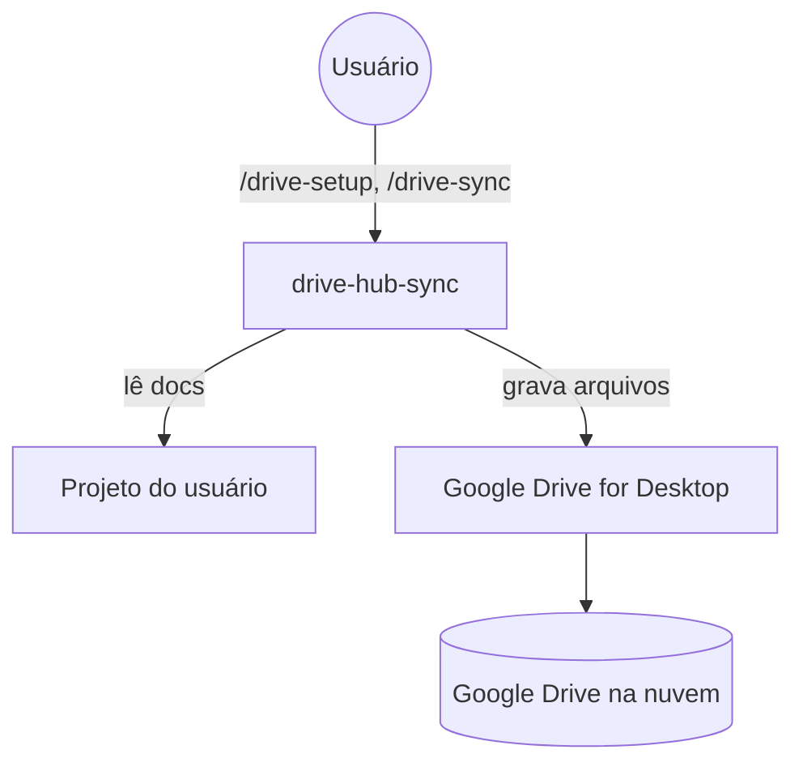
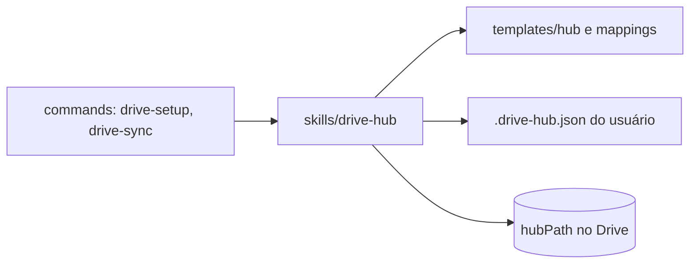

# Overview — drive-hub-sync

Plugin do Claude Code e skill do agy que criam, para cada projeto, uma pasta padronizada no Google Drive e a atualizam sob demanda com documentação executiva (releases, arquitetura, marketing). Nunca copiam código. Toda gravação passa por confirmação do usuário.

## Índice
- `stack.md` — tecnologias
- `modules.md` — componentes
- `flows.md` — fluxos principais
- `decisions.md` — decisões de design e ADRs
- `concepts.md` — conceitos e donos

---

## Arquitetura (C4 Model)

### Nível 1: Contexto

### Nível 2: Containers

